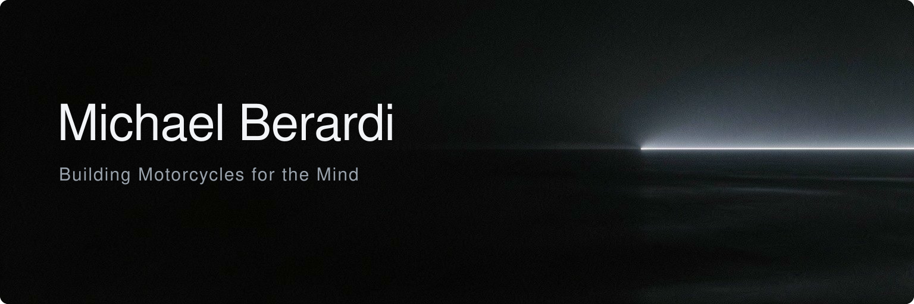

<picture>
  <source media="(max-width: 600px)" srcset="./assets/banner-mobile.svg">
  
</picture>

I'm Mike. I build [Pareto Cybernetics](https://paretocybernetics.com): open-source, local-first tools for working with AI agents. Most days a few dozen AI coding agents work alongside me, from New York and Buenos Aires.

These are the tools that way of working needed: memory the agents share, a browser they can drive, plans they keep, a bot to steer them from your phone, delegation that checks its own results, compaction that costs nothing, a benchmark that shows which harness does the job for less, a queue that gives their builds fair turns, and a reaper that cleans up after them. All of it is free and open source, runs on your own machine and keeps your data in plain files. Most have a page with a demo and an install command at [paretocybernetics.com](https://paretocybernetics.com).

## Agent infrastructure

| | |
|---|---|
| **[Carl](https://paretocybernetics.com/projects/carl/)** | A small bot gateway for steering your agents from your phone. It lives in Telegram, Slack and Discord, answers a status check across running jobs in 20.8 s on 67k prompt tokens where the Hermes gateway it replaced took 40.8 s on 373k, and shows you the exact command with Run once and Deny buttons before anything risky. Runs on your Claude Code or Codex login. [Source](https://github.com/michael-berardi/carl) `TypeScript` |
| **[Steak Pi](https://paretocybernetics.com/projects/steak-pi/)** | The [Pi coding agent](https://pi.dev), cooked properly. Native subagents, deterministic compaction, automatic verification, and a native TUI. Up to eight workers run in parallel, and compaction takes 10 to 300 ms with no model call. [Source](https://github.com/michael-berardi/steak-pi) `TypeScript` |
| **[Steak DSH](https://paretocybernetics.com/projects/steak-dsh/)** | One-shot coding tasks on dsh, for less. A plugin bundle and launcher for [DeepSeek Harness](https://github.com/deepseek-ai/deepseek-harness). It adds a check after every edit, owned paths for file edits, model flags and a full-screen terminal UI, and it can run on your Claude Code or Codex login. On the same model it used 0.70× to 0.92× of what stock DSH did across three benchmark runs, with every run correct. [Source](https://github.com/michael-berardi/steak-dsh) `JavaScript` |
| **[UltraCompress](https://paretocybernetics.com/projects/ultracompress/)** | Context compaction with no LLM in the loop. About 65 ms where Claude Code's own summarizer takes 23 to 52 seconds, at $0 per compaction, and anything it condenses stays searchable. Ships for Pi, Claude Code, Carl and Hermes Agent. [Source](https://github.com/michael-berardi/ultracompress) `Rust` |
| **[Retex](https://paretocybernetics.com/projects/retex/)** | A Markdown vault engine and machine-readable CLI for people and agents. Search, recall, backlinks, boards, undo, and MCP over an ordinary folder. No database to get locked into. [Source](https://github.com/michael-berardi/retex) `Swift` |
| **[ParetoBench](https://paretocybernetics.com/projects/paretobench/)** | An open benchmark that shows which coding-agent harness, or which model, gets the same tasks done correctly for the least cost and time. Twenty small Python tasks with hidden deterministic checkers, paired statistics and a marked Pareto frontier. Every run is on the [benchmarks page](https://paretocybernetics.com/benchmarks/). [Source](https://github.com/michael-berardi/paretobench) `Python` |
| **[UltraPlan](https://paretocybernetics.com/projects/ultraplan/)** | The plan the agent keeps and you can read. Phases in order, one active task, blocked means blocked. Survives compaction, resume, and a change of agent. [Source](https://github.com/michael-berardi/ultraplan) `TypeScript` |
| **[USAP](https://paretocybernetics.com/projects/usap/)** | A delegation protocol for subagents. Parallelize only what is actually independent, send each task to the cheapest model that can finish it, and treat "done" as evidence to check. [Source](https://github.com/michael-berardi/ultraterm-subagent-protocol) `Protocol` |
| **[UTP](https://paretocybernetics.com/projects/ultraterm-protocol/)** | Lets local agents inspect and drive persistent terminal sessions. JSON Lines over a `0600` Unix socket, and every destructive action dry-runs first. [Source](https://github.com/michael-berardi/ultraterm-protocol) `Python` |
| **[OverSeer Browser](https://paretocybernetics.com/projects/overseer-browser/)** | Model-agnostic browser automation for Chromium. Agents get their own window; your tabs stay yours until you lend one. [Source](https://github.com/michael-berardi/overseer-browser) `TypeScript` `Python` |
| **[UltraTerm Computer Use](https://paretocybernetics.com/projects/ultraterm-computer-use/)** | Desktop automation for any MCP-capable agent on macOS, Linux, and Windows that works in the background: it does not take focus or move your pointer, and it refuses actions aimed at a stale screen. Screenshots and keystrokes never leave the machine. [Source](https://github.com/michael-berardi/ultraterm-computer-use) `Swift` |
| **[Rusty Mirror](https://paretocybernetics.com/projects/rusty-mirror/)** | A hidden, disposable twin of your real Tauri app window, so agents can poke, screenshot and hot-swap the actual app instead of a browser stand-in. [Source](https://github.com/michael-berardi/rusty-mirror) `Rust` |
| **[Smart Build](https://paretocybernetics.com/projects/smart-build/)** | One fair queue for every heavy build on the machine. A couple of builds run at once, one per repo, in the order they arrived, and the whole process tree stops on Ctrl-C, a timeout or a killed agent. A burst of 12 builds finishes in 3.9 s where the queue it replaced took 11.6 s. No daemon, no dependencies. [Source](https://github.com/michael-berardi/smart-build) `Python` |
| **[TrimReaper](https://paretocybernetics.com/projects/trimreaper/)** | Reclaims the disk agent swarms leave behind: clones, `node_modules`, Rust targets, scratch and screenshots. Deletes only what it can prove is safe, archives unsaved work first, and writes a receipt before every removal. CLI and MCP server. [Source](https://github.com/michael-berardi/TrimReaper) `Python` |

## Apps

| | |
|---|---|
| **[Skribi](https://github.com/michael-berardi/skribi)** | A calm reader and editor for Markdown libraries and Retex vaults. Imports Obsidian and Notion without holding your notes hostage. `Rust` |
| **[Concept](https://paretocybernetics.com/projects/concept/)** | Pages, databases and boards for your team, stored as plain Markdown. Self-host it or use the native Mac app, sync with Git, and read the same folder with Retex. [Source](https://github.com/michael-berardi/concept) `TypeScript` |
| **[Good Night](https://paretocybernetics.com/projects/goodnight/)** | Warms your screen after sunset and dims it all the way to black, external monitors included. Free for macOS and Windows. [Download](https://github.com/michael-berardi/goodnight/releases/latest) `Swift` |
| **[UltraLink](https://paretocybernetics.com/projects/ultralink/)** | Your Starlink connection, live in the Mac menu bar: speed, outages, history and the sky view. Read-only, no account, no cloud. [Download](https://github.com/michael-berardi/ultralink/releases/latest) `Swift` |
| **[OpenMail](https://github.com/michael-berardi/openmail)** | An open mail client for people and agents. A signed Mac app on the system web view (about 45 MB of memory), IMAP push, offline queue, Apple Mail import, and an MCP server where agents triage and draft but sending waits for your approval. [Download](https://github.com/michael-berardi/openmail/releases/latest) `Go` |

## Libraries and methods

| | |
|---|---|
| **[Champollion](https://paretocybernetics.com/projects/champollion/)** | An open method and offline toolkit for translating complete works directly from their originals, with the checks to prove it. Grew out of [Mouseia](https://mouseia.org). [Source](https://github.com/michael-berardi/champollion) `Python` |
| **[Carapace](https://paretocybernetics.com/projects/carapace/)** | Write your app's brain once in Rust and give each platform a thin, generated shell: SwiftUI, Tauri, or anything that can call C. Good Night runs on it. [Source](https://github.com/michael-berardi/carapace) `Rust` |
| **[ultra-media-remote](https://paretocybernetics.com/projects/ultra-media-remote/)** | Reads and controls macOS Now Playing from safe Rust, without linking Apple's private framework. [Source](https://github.com/michael-berardi/ultra-media-remote) `Rust` |

## How it's built

Your data stays on your machine. Permissions and failure modes are designed first. Every dependency earns its place, and every number ships with the benchmark behind it.

## Work with me

Issues and pull requests are welcome on any repo here. For news and releases, follow [Pareto Cybernetics](https://paretocybernetics.com).

My agency, [Liberty Design Studio](https://libertydesign.studio/), builds websites, brands and search strategy for businesses.
