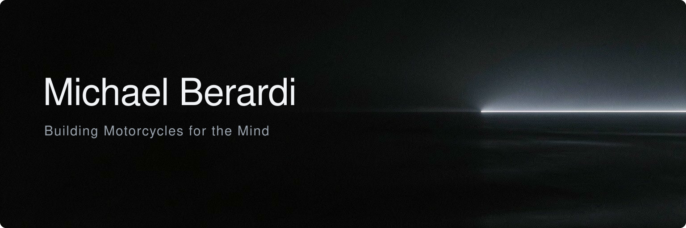

<picture>
  <source media="(max-width: 600px)" srcset="./assets/banner-mobile.svg">
  
</picture>

I build [Pareto Cybernetics](https://paretocybernetics.com): open-source tools for working with AI agents, desktop apps and libraries that run locally.

## Agent infrastructure

| Project | What it does |
|---|---|
| **[Carl](https://github.com/michael-berardi/carl)** | Connects agents to chat, a web app and an API so you can supervise work, approve actions and schedule tasks. |
| **[Steak Pi](https://github.com/michael-berardi/steak-pi)** | Adds subagents, local context compaction, edit verification and local models with their harness adapters to the Pi coding agent. |
| **[Steak DSH](https://github.com/michael-berardi/steak-dsh)** | Adds model selection (local models and Gemini through Google's Antigravity CLI included), edit checks and file-edit boundaries to DeepSeek Harness through a plugin bundle and launcher. |
| **[codex-on-claude-code](https://github.com/michael-berardi/codex-on-claude-code)** | Connects the stock Codex CLI to your Claude Code login through a local bridge. |
| **[UltraCompress](https://github.com/michael-berardi/ultracompress)** | Compacts agent context locally without a model call while keeping the original session searchable. |
| **[Retex](https://github.com/michael-berardi/retex)** | Searches and manages Markdown vaults through a machine-readable CLI and MCP server. |
| **[ParetoBench](https://github.com/michael-berardi/paretobench)** | Compares coding-agent harnesses and models on the same tasks for correctness, cost and time. |
| **[UltraPlan](https://github.com/michael-berardi/ultraplan)** | Tracks phased agent tasks and their progress in local JSON and Markdown files. |
| **[UltraTerm Subagent Protocol (USAP)](https://github.com/michael-berardi/ultraterm-subagent-protocol)** | Guides adaptive delegation according to independent work and host capacity, with bounded assignments and review of every result. |
| **[UltraTerm Terminal Protocol (UTP)](https://github.com/michael-berardi/ultraterm-protocol)** | Lets local agents inspect and control persistent UltraTerm terminal sessions through a private Unix socket. |
| **[OverSeer Browser](https://github.com/michael-berardi/overseer-browser)** | Controls Chromium through a local CLI, browser extension and native host. |
| **[UltraTerm Computer Use](https://github.com/michael-berardi/ultraterm-computer-use)** | Lets agents inspect and operate desktop apps through a local skill and CLI on macOS, Linux and Windows. |
| **[Rusty Mirror](https://github.com/michael-berardi/rusty-mirror)** | Gives Tauri developers and testing agents a hidden second app window for inspecting and trying frontend changes. |
| **[Smart Build](https://github.com/michael-berardi/smart-build)** | Queues heavy builds and tests per user, limits concurrency and serializes work in each Git worktree. |
| **[TrimReaper](https://github.com/michael-berardi/TrimReaper)** | Reclaims disk space left by coding agents on macOS after checking job state, Git and retention rules. |

## Apps

| Project | What it does |
|---|---|
| **[Skribi](https://github.com/michael-berardi/skribi)** | Reads and edits long works, Markdown libraries and Retex vaults as ordinary files. |
| **[Concept](https://github.com/michael-berardi/concept)** | Organizes team pages, databases and boards in Markdown through a Mac app or self-hosted web app. |
| **[Good Night](https://github.com/michael-berardi/goodnight)** | Warms screens after sunset and dims supported displays on macOS and Windows. |
| **[UltraLink](https://github.com/michael-berardi/ultralink)** | Shows Starlink traffic, outages and obstructions in the Mac menu bar without changing dish settings. |
| **[OpenMail](https://github.com/michael-berardi/openmail)** | Stores and searches IMAP mail locally, with a web app, Mac app, command-line tools and scoped MCP access. |
| **[UltraVox](https://github.com/michael-berardi/ultravox)** | Transcribes speech and media on-device, with an open-source core and optional Pro features in official builds. |

## Games

Free to play in the browser at [paretocybernetics.com/games](https://paretocybernetics.com/games/).

| Game | What it is |
|---|---|
| **[Castles of Sand](https://paretocybernetics.com/games/castles-of-sand/)** | A first-person multiplayer demolition game: wreck a private island villa, block by block, with real structural collapse. |
| **[Load Bearing](https://paretocybernetics.com/games/load-bearing/)** | A first-person voxel demolition game: find what holds a four-storey mill up, cut exactly that, and the floors crush down by themselves. |
| **[Rust Belt](https://paretocybernetics.com/games/rust-belt/)** | A pixel-art wrecking game: take a working automated foundry apart, part by part, by cutting its power, belts and fuel. |
| **[Amoeba](https://paretocybernetics.com/games/amoeba/)** | Life in a drop of pond water. |

## Libraries and methods

| Project | What it does |
|---|---|
| **[Champollion](https://github.com/michael-berardi/champollion)** | Keeps originals, translations and review evidence together and checks structure and provenance with offline tools. |
| **[Carapace](https://github.com/michael-berardi/carapace)** | Shares a Rust application core across SwiftUI, Tauri and Node interfaces using generated bindings. |
| **[ultra-media-remote](https://github.com/michael-berardi/ultra-media-remote)** | Reads macOS Now Playing metadata and controls playback from Rust. |

## Community

| Repository | What it contains |
|---|---|
| **[.github](https://github.com/michael-berardi/.github)** | Provides default community guidelines, support information and contribution templates. |
| **[michael-berardi](https://github.com/michael-berardi/michael-berardi)** | Maintains this profile and its project directory. |

Issues and pull requests are welcome in each project repository.
